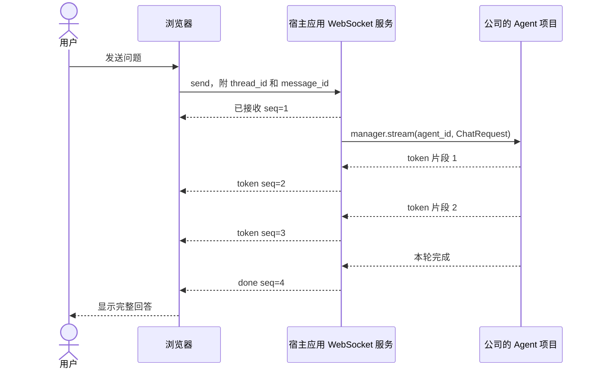
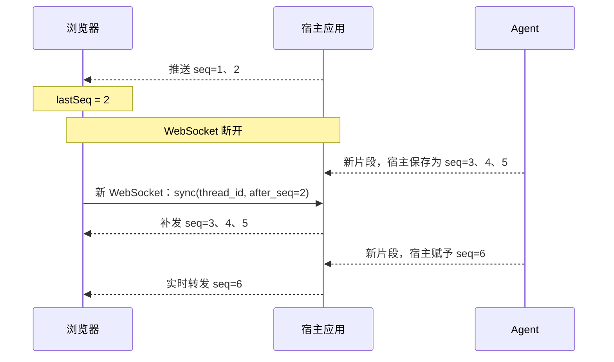
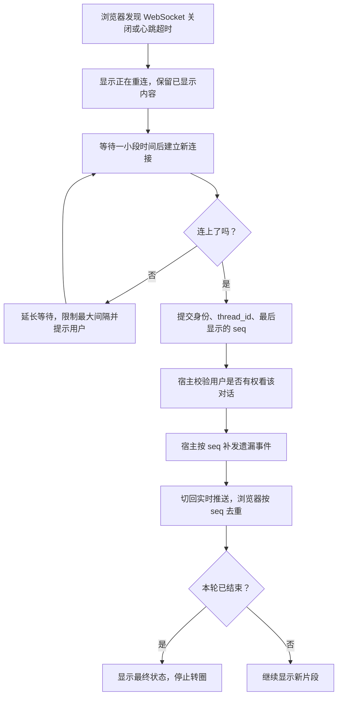

想象你正在和 AI 助手聊天。你问“帮我整理这份计划”，屏幕上已经出现“第一步……”，手机切到地铁隧道后，字突然不动了。过一会儿网络恢复，你希望看见后面的回答，而不是又发一遍问题、生成两份计划。

示例里的浏览器会在收到断开通知后先等 **1 秒**，再创建一条新的 WebSocket。连续连接失败时，每次等 **2 秒、4 秒，之后每次 8 秒**。这段时间里，服务端仍可生成并保存回答。新连接建立后，浏览器带着最后处理的事件序号来补收漏掉的片段。

> 本文里的**宿主应用**就是为浏览器提供聊天功能的后端。它可以调用公司的 Agent 项目 生成回复、读取历史和取消任务。WebSocket、等待时间、事件补发和浏览器行为由宿主及其前端决定。文中的等待时间与消息格式来自本文的本地 demo。要确认某个实际聊天产品的配置，需要查看那款产品的前后端代码。

## 1. 先用打电话来理解

你和朋友打电话时，电话线是**连接**，聊天主题是**对话**。电话断了，你重新拨通，聊天主题并不会自动消失；但电话断开期间朋友说过的话，你可能没听到，需要请朋友补一句。

| 对话系统里的词 | 普通人的理解 | 常见标识 |
| --- | --- | --- |
| WebSocket 连接 | 当前这通电话 | 每连一次都会换 |
| 对话 | 你和助手的整个聊天 | `thread_id` |
| 本轮提问 | 你刚问的这一句话 | `message_id` 或 `turn_id` |
| 流式事件 | 提问确认、一小段回答、回答完成等通知 | `seq`，在同一对话内从 1 递增 |
| 重连 | 电话重新拨通 | 建立新的 WebSocket |
| 补发 | 把断线期间漏听的话重说 | 按序号回放事件 |

**最容易混淆的地方**：重连只让你重新“听得见”；要接着看原来的回答，还需要服务端知道你漏听到哪里，并保存或能查到那些内容。

## 2. 正常聊天怎样经过 WebSocket

浏览器先与宿主应用建立 WebSocket，再发送用户消息。宿主调用 公司的 Agent 项目的 `manager.stream(agent_id, ChatRequest(...))`，逐个拿到 Agent 的流式事件，再转发给浏览器。浏览器把片段拼在屏幕上。

下面是宿主接入公司的 Agent 项目 时的最小片段。每次 `async for` 取到一个事件，宿主就可以给它编号、保存并推送。第 7 节的 demo 用定时生成的文字代替了这段 Agent 调用。

```python
from contextlib import aclosing

# ChatRequest 由公司的 Agent 项目提供，按实际接入方式导入

request = ChatRequest(messages="帮我整理计划", thread_id="chat-42")
async with aclosing(manager.stream(agent_id, request)) as events:
    async for event in events:
        # 由宿主实现：编号、保存、通知当前订阅者
        await store_and_publish(request.thread_id, event)
```

`ChatRequest` 把问题和对话 ID 交给公司的 Agent 项目。`async for` 让宿主拿到一段就处理一段。`aclosing` 会在消费任务退出时关闭流，因此想让生成跨越断线，就需要让这段循环由独立的生成任务运行。上面的 `manager`、`agent_id` 和 `store_and_publish` 由宿主提供。


<details>
<summary>Mermaid 源码</summary>



</details>

这里的 `seq`、`message_id`、`send/done` 是**本文建议宿主定义的 WebSocket 消息格式**，不是 Agent 项目规定的字段。公司的 Agent 项目通过 `ChatRequest.thread_id` 识别对话。如果不提供，构造请求时会自动生成一个新的 ID。重连时想回到原对话，宿主必须保留原来的 `thread_id`。

### 浏览器和服务端实际交换的 JSON

下面用 `m-1` 代替 demo 生成的长 UUID。每行是 **一条独立的 WebSocket 消息**。发送方写在右侧，实际消息里只有 JSON。

| 方向 | JSON | 代码怎么用它 |
| --- | --- | --- |
| 浏览器 → 服务端 | `{"type":"sync","thread_id":"demo-thread","after_seq":0}` | 页面初次连接，`lastSeq` 为 0，订阅该对话并读取已有事件 |
| 浏览器 → 服务端 | `{"type":"send","thread_id":"demo-thread","message_id":"m-1","text":"你好"}` | `handler()` 找到对话，检查这条提问是否已经接收 |
| 服务端 → 浏览器 | `{"type":"user","seq":1,"message_id":"m-1","text":"你好"}` | 显示用户气泡，同时确认服务端收到了这条提问 |
| 服务端 → 浏览器 | `{"type":"token","seq":2,"message_id":"m-1","text":"你好，"}` | 找到 `answer-m-1` 对应的回复气泡并追加文字，没有气泡则先创建 |
| 服务端 → 浏览器 | `{"type":"done","seq":7,"message_id":"m-1"}` | 将这轮标记为完成，序号 3 到 6 对应中间的四个文字片段 |

`seq` 数的是事件，`text` 里可以有多个字。服务端用 `len(room.events) + 1` 给事件编号，再执行 `room.events.append(event)`。所以一条提问和它的回答可以共用同一个 `message_id`，每条事件却有自己的 `seq`。WebSocket 的 `send()` 把数据交给浏览器发送，业务确认要等服务端回传 `type: "user"`。 [WebSocket 发送接口](https://websockets.spec.whatwg.org/#dom-websocket-send)

## 3. 为什么会断线？用户会看到哪些情况

断线并不一定是“服务器坏了”。常见原因有：

- 手机在 Wi-Fi 和移动网络间切换，或者经过信号弱的地方。
- 浏览器标签页休眠、电脑睡眠、网络设备或代理切断空闲连接。
- 宿主服务重启、部署新版本，或中间的网关超时。
- 用户刷新页面、关闭标签页，或服务端主动关闭连接。

还要区分 **“连接断了”** 和 **“AI 本轮任务停了”**。两者没有必然的等号。断线时可能出现三种结果：

| 服务端实际情况 | 用户看到的表象 | 重连后应该怎样处理 |
| --- | --- | --- |
| Agent 继续生成，事件被宿主保存 | 页面不再出字 | 重连后补发漏掉的片段，再接实时片段 |
| 宿主因断线取消了流 | 页面不再出字 | 告知本轮已中断；读取已有历史，按产品规则让用户重新发起 |
| 生成已完成，但完成通知丢了 | 页面一直显示“生成中” | 补发最终结果和 `done`，让页面结束转圈 |

在 demo 中，点击“模拟断线”会执行 `socket.close()`，浏览器随后收到 `close` 事件。实际遇到掉线或代理断开时，浏览器发现连接关闭后也会走这个回调。**发现断线可能需要时间**。例如突然失去信号时，双方可能暂时还以为连接可用。实际产品可以用心跳和超时来辅助检测，demo 用按钮直接触发关闭，方便观察重连。

页面不出新字也可能只是模型生成得慢。可以看浏览器是否收到 `close`，再看宿主有没有收到生成任务的完成或失败状态。这两个信号分别回答“连接是否关闭”和“任务是否结束”。

### 谁先发现断线，取决于怎么断的

| 情况 | 代码从哪里知道 | 页面何时开始重连 |
| --- | --- | --- |
| 点击 demo 的“模拟断线” | 浏览器主动执行 `socket.close()`，稍后触发 `onclose` | 收到 `onclose` 后启动定时器 |
| 网线拔了或信号突然消失 | 对端可能收不到关闭通知，要等系统检测到连接失败，或等心跳探测超时 | 浏览器检测到并触发 `onclose` 后才计时，用户体感可能明显超过 1 秒 |
| 网络还通，但 Agent 正在等工具或模型 | 这段时间可能没有 `token`，连接仍可能是 `OPEN` | demo 继续等待输出。宿主要另行判断任务是否超时 |

心跳是定期检查连接能否来回传消息。WebSocket 协议有 Ping 和 Pong，浏览器 JavaScript 的 WebSocket 接口没有暴露这种控制帧。服务端库可以发协议 Ping。若页面需要自己规定探测时点和超时，也可以与服务端约定 `{"type":"ping"}` 和 `{"type":"pong"}` 这样的应用消息。demo 的 JS 没有实现应用层心跳，Python 端的 `serve()` 使用库默认配置。 [浏览器的 Ping/Pong 接口说明](https://websockets.spec.whatwg.org/#ping-and-pong-frames) · [Python 服务端参数](https://websockets.readthedocs.io/en/15.0.1/reference/asyncio/server.html#creating-a-server)

## 4. “接着看”为什么比“自动重连”多两步

假设浏览器处理了事件 1、2，连接在收到事件 3 前断开。服务端随后保存了事件 3、4、5。


<details>
<summary>Mermaid 源码</summary>



</details>

这里有三个独立动作：

1. **重新连上**：浏览器创建一个新的 WebSocket。
2. **找回位置**：浏览器告诉服务端“我最后确实显示到 `seq=2`”。
3. **补齐并去重**：服务端回放 `seq>2` 的事件；浏览器遇到已显示的序号就忽略。

只写 `socket.onclose = () => new WebSocket(...)`，最多完成第一步。漏掉的字仍然会漏掉。

浏览器每次连上后会用下面的消息报出自己的进度。`after_seq: 2` 的意思是“我已经处理到第 2 条，请从第 3 条开始”。

```json
{"type":"sync","thread_id":"demo-thread","after_seq":2}
```

服务端遍历 `room.events`，用 `if event["seq"] > after:` 选出遗漏事件，再用 `room.listeners.add(ws)` 把新连接加入实时订阅。第 7 节的两行代码放在同一个 `async with room.lock:` 里，生成任务也用这把锁。如果生成任务先拿到锁，新片段就进入本次补发。如果重连处理先拿到锁，浏览器会先加入订阅，新片段随后通过实时推送到达。

举例说，服务端开始补发时已经保存到 5，这时又产生第 6 条。如果“读旧事件”和“加入订阅”各做各的，第 6 条可能正好在两步之间发布，浏览器就漏掉了。demo 让两个步骤共用一把锁，生成任务会等到补发完成、订阅登记之后再发布第 6 条。

页面用 `if (event.seq <= lastSeq) return;` 忽略重复事件。比如刚处理过 3，又收到一个 3，就跳过。这个判断依赖服务端按顺序交付连续事件。在实际宿主中，如果页面目前到 2，却收到 4，可以暂留 4 并请求从 2 开始补齐，避免先把游标推进到 4，之后又误把迟到的 3 当成重复。

### 为什么还要给用户提问一个 `message_id`？

假设你按下发送，服务端已收到问题，但“已接收”通知恰好丢了。浏览器不知道消息有没有送达。如果重连后把问题当新消息发一次，Agent 可能回答两遍，甚至调用工具两遍。

宿主可以给每次用户提交一个固定的 `message_id`。同一个 ID 再来时，宿主返回已有状态或补发事件，不再启动第二轮 Agent。**去重需要服务端实现；浏览器单独记住 ID 不够。**

demo 在点击发送时用 `crypto.randomUUID()` 生成一次 ID，并把整条提问存在 `pending`。若确认丢了，`onopen` 会把原来的 `pending` 发出去，所以第二次仍带同一个 ID。服务端的 `if message_id not in room.message_ids:` 判断只允许第一次进入创建生成任务的分支。浏览器收到匹配的 `user` 事件后，才把 `pending` 清空。

| 断线时服务端做到了哪一步 | 重连时会发生什么 |
| --- | --- |
| 还没收到提问 `m-1` | 重发同一个 ID。服务端第一次见到它，记录提问并启动生成 |
| 已接收 `m-1`，确认在路上丢了 | 新连接先发 `sync`，再重发 `pending`。补发的 `user` 事件让页面清除 `pending`，服务端看到重复 ID 时跳过第二次执行 |
| 已经收到确认，后来才断线 | `pending` 已清空，重连时只发 `sync`，从上次处理到的位置接收事件 |

在 demo 里，“查 ID”和“记住 ID”都在 `room.lock` 中，两个连接同时重发也只能有一个先通过判断。真实宿主如果有多个服务进程，需要共同读写一处具备唯一约束的存储，例如让 `(thread_id, message_id)` 唯一。接收记录和后续任务也要能核对，否则服务进程可能刚记下“已接收”就退出，重发时才发现原任务并未成功入队。

## 5. 公司的 Agent 项目在重连中负责什么

下面是读源码时最重要的对应关系：

| 能力 | 源码 | 对 WebSocket 重连的意义 |
| --- | --- | --- |
| 对话 ID | `request.py` 的 `ChatRequest.thread_id` | 宿主用同一个 ID 定位原对话；它不是 WebSocket 连接 ID |
| 流式输出 | `manager.py` 的 `stream()` 与 `agent.py` 的 `stream()` | 宿主可以把事件转成 WebSocket 消息 |
| 历史读取 | `manager.py` 的 `get_history()` | 可在重连后核对已保存的对话消息 |
| 主动取消 | `manager.py` 的 `cancel()` | 宿主可选择断线时停止本轮，但这属于产品策略 |
| 检查点 | `agent.py` 的 `_resolve_checkpointer()` | 保存 Agent 的执行状态。可显式指定、禁用或复用记忆存储，最后尝试 SQLite |
| 提前关闭流 | `slash/runtime.py` 与 `test_early_stream_close.py` | 消费端提前退出时应正确关闭异步流，释放资源 |

公司的 Agent 项目使用 LangGraph 将执行过程输出为事件。流会把图事件投影为 `token` 等事件，相关代码位于 `protocols/langgraph.py`。但它**没有**替宿主给 WebSocket 事件编号、保存逐字片段、认证重连用户或按序号回放。

例如，宿主要显示这段对话最近保存的消息，可以这样调用：

```python
history = await manager.get_history(agent_id, thread_id="chat-42", limit=50)
```

这个调用沿着 `get_history()` → `aget_history()` 读取检查点，得到按时间顺序排列的对话消息。分页参数 `before` 接收检查点 ID。它与 demo 的 `after_seq` 属于两套编号。需要逐片段补发时，宿主需保留带 `seq` 的事件。若只需恢复已保存的对话，可以读取当前历史并重新显示已有消息。 对应实现位于 `agent.py` 的 `aget_history()`。

### 断线后 Agent 还会继续吗？

这取决于**宿主怎么管理流任务**。如果宿主把 `manager.stream()` 的消费任务和 WebSocket 连接绑在一起，WebSocket 断开时消费者退出，流可能被提前关闭；公司的 Agent 项目有显式关闭嵌套异步流的逻辑。若宿主把生成任务独立运行，并把事件写入可回放的存储，前端断线后任务可以继续。

例如，宿主若在断线处理里主动调用 `manager.cancel(agent_id, thread_id)`，请求会转给 Agent。Agent 的 `cancel()` 设置本轮的取消信号，`_iter_until_cancelled()` 可以在等待下一个模型或工具事件时响应它，随后清理迭代器。已经执行过的工具动作不会因取消而回滚。demo 的断线处理只移除订阅连接，因此生成任务继续运行。 两个入口分别在 `manager.py` 和 `agent.py` 的 `cancel()`。

**不要把 HITL 的 `resume_hitl()` 当成网络重连接口**。它是人工审批暂停后提交审批决定的功能，语义不同；调用它不会自动补发 WebSocket 丢掉的回答片段。

## 6. 一个适合宿主应用的解决流程

### 是先停一段时间再去重连吗？

**在本文 demo 里，是浏览器先等一会儿再尝试连接。服务端的生成任务在这段时间可以继续。** 等待从浏览器接到 `close` 事件开始计时。真实宿主的等待时间要看它的前端实现，WebSocket 本身没有给聊天应用设定这套重连计时。

这是第 7 节的原代码，负责计算等待时间并发起下一次连接。

```javascript
const delay = Math.min(1000 * 2 ** retryCount++, 8000);
setTimeout(connect, delay);
```

1. `retryCount` 从 `0` 开始。后缀 `++` 表示先拿当前值计算，再把计数加 1。
2. `1000 * 2 ** retryCount` 算出毫秒数。每次连续失败，基础等待翻倍。这种做法叫**指数退避**。
3. `Math.min(..., 8000)` 把单次等待限制在 8 秒。
4. `setTimeout(connect, delay)` 安排下一次调用 `connect()`，页面这期间仍能显示已有内容。表格里的时间是每次检测到连接关闭后安排的等待，实际还要算上连接尝试耗时和浏览器调度时间。
5. `onopen` 执行 `retryCount = 0`。一次连接成功后，下次再掉线就重新从 1 秒开始。

| 第几次连续尝试重连 | 使用的计数 | 这次等待 |
| --- | --- | --- |
| 第 1 次 | 0 | 1 秒 |
| 第 2 次 | 1 | 2 秒 |
| 第 3 次 | 2 | 4 秒 |
| 第 4 次及以后 | 3 及以上 | 8 秒 |

等待让短暂的网络波动有机会恢复。服务端刚重启时，逐步拉长间隔也可以减少大量客户端同时反复连接的压力。实际产品常在间隔上加一点随机量，让不同用户错开。demo 里的 8 秒是**单次间隔上限**，它会继续尝试，直到连上或关闭页面。

页面打开时，最后一行 `connect()` 会立刻尝试首次连接。收到断开通知后才用定时器。比如第 1 次重连等待 1 秒，连接尝试用 3 秒才返回失败，则第 2 次要在那次失败后再等 2 秒，粗略算是最初收到断开通知后的第 6 秒。浏览器标签页在后台时，实际定时器还可能延后。对于异常断开后需要重连的客户端，协议也建议错开首次重连、逐步拉长后续间隔。 [RFC 6455 的异常关闭恢复建议](https://www.rfc-editor.org/rfc/rfc6455.html#section-7.2.3)

demo 在 `onopen` 就显示“已连接”。这时浏览器刚建好连接，尚未处理补发。实际产品可以让服务端在回放后发送一条单独的 `sync_done` 通知，页面收到通知并处理完之前的事件后再显示“已同步”。登录过期时，产品也可以停止自动重试并提示重新登录。

服务端那边，`asyncio.create_task(generate(room, message_id))` 已经启动了独立的生成任务。断线处理的 `finally` 只从 `room.listeners` 移除旧 WebSocket。接下来每次 `generate()` 产出文字，`room.events.append(event)` 仍会保存片段，哪怕订阅列表暂时为空。重连成功后，浏览器再发 `sync` 取回这些片段。

### 从断线提示到恢复回答


<details>
<summary>Mermaid 源码</summary>



</details>

落地时，宿主至少需要约定：

- **身份与权限**：不能只凭猜到的 `thread_id` 就读取别人的聊天。每次新连接都要重新校验。
- **消息确认**：用户提问带 `message_id`；服务端记录“已接收/运行中/已完成”，重复 ID 不重复执行。
- **事件顺序**：每个对话的事件有稳定、递增的 `seq`。服务端先处理“补发与订阅实时流”的交界，避免刚补完又漏一段。
- **存储期限**：断线几秒和隔天再来是不同需求。事件保存多久、超过期限后怎样回退到历史消息，要明确。
- **重连节奏**：短暂网络抖动时自动再连，间隔逐渐变长并加入随机抖动；持续失败时告诉用户当前状态。浏览器 JavaScript 不能直接发送 WebSocket 协议级 Ping，心跳可由服务端处理，或另约应用层心跳。
- **任务策略**：明确“断线继续生成并存事件”还是“断线取消本轮”。前者体验更连贯，但需要宿主管理独立任务与事件存储。

如果浏览器带着 `after_seq=2` 回来，但服务端已经清掉 3 到 19，只保留 20 之后的事件，直接从 20 开始追加会漏字。一种实现是返回 `sync_required`，页面重取一份完整的聊天显示状态，并用与这份状态一致的序号继续订阅。如果只能查到 Agent 项目中已保存的消息，就先恢复这些消息，由宿主再提供本轮运行状态。生成失败或被取消时，也应有对应的结束状态供页面收尾。

## 7. 本地小 demo：亲手断开，再补回漏掉的回答

这个例子使用 Python 的 `websockets` 包和浏览器原生 WebSocket。把两个文件放在同一个演示目录。示例使用 `websockets 15.0.1`。如果所用的 Python 环境还没安装，运行 `python -m pip install websockets==15.0.1`。演示服务监听本机，事件只保存在进程内存。 [Python WebSocket 服务端文档](https://websockets.readthedocs.io/en/15.0.1/reference/asyncio/server.html)

### 文件一：`server.py`

```python
import asyncio
import json
from collections import defaultdict

from websockets.asyncio.server import serve
from websockets.exceptions import ConnectionClosed


class Room:
    def __init__(self):
        self.events = []           # 已产生的事件，供重连补发
        self.message_ids = set()    # 相同用户消息只执行一次
        self.listeners = set()      # 当前在线的 WebSocket
        self.lock = asyncio.Lock()  # 补发和实时发送之间不留缝隙


rooms = defaultdict(Room)


async def publish_locked(room, event):
    event["seq"] = len(room.events) + 1
    room.events.append(event)
    data = json.dumps(event, ensure_ascii=False)
    for ws in tuple(room.listeners):
        try:
            await ws.send(data)
        except ConnectionClosed:
            room.listeners.discard(ws)


async def generate(room, message_id):
    # 假装 Agent 逐段生成；即使浏览器断开，这个任务仍继续。
    for word in ["你好，", "这是一个", "断线后", "仍会继续", "生成的回答。"]:
        await asyncio.sleep(0.8)
        async with room.lock:
            await publish_locked(
                room, {"type": "token", "message_id": message_id, "text": word}
            )
    async with room.lock:
        await publish_locked(room, {"type": "done", "message_id": message_id})


async def handler(ws):
    joined = set()
    try:
        async for raw in ws:
            request = json.loads(raw)
            room = rooms[request["thread_id"]]
            if request["type"] == "sync":
                async with room.lock:
                    after = request["after_seq"]
                    for event in room.events:
                        if event["seq"] > after:
                            await ws.send(json.dumps(event, ensure_ascii=False))
                    room.listeners.add(ws)
                joined.add(room)
            elif request["type"] == "send":
                message_id = request["message_id"]
                async with room.lock:
                    if message_id not in room.message_ids:
                        room.message_ids.add(message_id)
                        await publish_locked(
                            room,
                            {
                                "type": "user",
                                "message_id": message_id,
                                "text": request["text"],
                            },
                        )
                        asyncio.create_task(generate(room, message_id))
    finally:
        for room in joined:
            room.listeners.discard(ws)


async def main():
    async with serve(handler, "127.0.0.1", 8765):
        print("WebSocket 已启动：ws://127.0.0.1:8765")
        await asyncio.Future()


asyncio.run(main())
```

### 文件二：`chat.html`

```html
<!doctype html>
<meta charset="utf-8">
<title>对话断线重连演示</title>
<p id="status">准备连接</p>
<input id="question" value="你好" />
<button id="send">发送</button>
<button id="drop">模拟断线</button>
<div id="messages"></div>
<script>
  const threadId = "demo-thread";
  const statusEl = document.getElementById("status");
  const messages = document.getElementById("messages");
  let socket;
  let lastSeq = 0;         // 已经显示的最后一个事件号
  let retryCount = 0;
  let pending = null;      // 未收到“已接收”事件的提问

  function connect() {
    socket = new WebSocket("ws://127.0.0.1:8765");
    socket.onopen = () => {
      retryCount = 0;
      statusEl.textContent = "已连接";
      socket.send(JSON.stringify({
        type: "sync", thread_id: threadId, after_seq: lastSeq
      }));
      if (pending) socket.send(JSON.stringify(pending));
    };
    socket.onmessage = ({ data }) => {
      const event = JSON.parse(data);
      if (event.seq <= lastSeq) return; // 补发与实时流重叠时去重
      lastSeq = event.seq;
      if (event.type === "user") {
        const line = document.createElement("p");
        line.textContent = "你：" + event.text;
        messages.append(line);
        if (pending?.message_id === event.message_id) pending = null;
      } else if (event.type === "token") {
        let line = document.getElementById("answer-" + event.message_id);
        if (!line) {
          line = document.createElement("p");
          line.id = "answer-" + event.message_id;
          line.textContent = "助手：";
          messages.append(line);
        }
        line.textContent += event.text;
      } else if (event.type === "done") {
        statusEl.textContent = "本轮回答完成";
      }
    };
    socket.onclose = () => {
      statusEl.textContent = "连接中断，正在重连……";
      const delay = Math.min(1000 * 2 ** retryCount++, 8000);
      setTimeout(connect, delay);
    };
  }

  document.getElementById("send").onclick = () => {
    if (pending) return; // 小 demo 同时只允许一条待确认提问
    pending = {
      type: "send", thread_id: threadId,
      message_id: crypto.randomUUID(),
      text: document.getElementById("question").value
    };
    if (socket.readyState === WebSocket.OPEN) {
      socket.send(JSON.stringify(pending));
    } // 当前断线时，onopen 会发送这条待确认消息
  };
  document.getElementById("drop").onclick = () => socket.close();
  connect();
</script>
```

### 跟着代码启动和观察

1. 在演示目录打开两个终端。第一个运行 `python server.py`，让 WebSocket 服务在本机 8765 端口等待连接。
2. 第二个运行 `python -m http.server 8000 --bind 127.0.0.1`，用来打开页面。浏览器访问 `http://127.0.0.1:8000/chat.html`。8000 负责提供页面，页面里的 JS 会连到 8765 收发聊天消息。
3. 打开浏览器开发者工具，在「网络」里选「WS」。点「发送」，出现“你好，”后立刻点「模拟断线」。
4. 稍等片刻，在「WS」列表选择新连接，打开「消息」页签。你会看到发出的 `sync`，和收到的后续 `token`、`done`。页面会显示完整回答。

### 走读一次具体的断线

假设只有一轮对话，且页面刚处理完 `seq=2` 时断线。下面从服务端接收提问开始计时，忽略本机握手与调度的细小延迟。

| 约在第几秒 | 代码走到哪 | 页面和服务端发生什么 |
| --- | --- | --- |
| 0.0 | `handler()` 收到 `send`，发布 `user`，然后启动 `generate()` | 服务端记下 `seq=1`，页面显示你的提问并清除 `pending` |
| 0.8 | `generate()` 第一次从 `sleep(0.8)` 返回 | 推送 `seq=2` 的“你好，”，页面创建助手气泡，`lastSeq` 变成 2 |
| 0.9 | 你点断线，`onclose` 安排约 1 秒后的 `connect()` | 页面显示“正在重连”，服务端把旧连接移出 `listeners` |
| 1.6 | 生成任务发布 `seq=3` 的“这是一个” | `room.events.append(event)` 已把它保存，页面暂时还看不到 |
| 1.9 | 新连接打开，`onopen` 发送 `after_seq: 2` | 服务端发现第 3 条待补发，发完后把新连接放进 `listeners` |
| 2.4 | 生成任务发布 `seq=4` 的“断线后” | 新连接直接收到实时事件，`line.textContent += event.text` 把文字加到同一个气泡 |
| 4.0 左右 | 最后一段文字是 `seq=6`，随后的 `done` 是 `seq=7` | 页面显示“本轮回答完成” |

生成的 0.8 秒间隔由 Python 控制，重连的 1 秒间隔由浏览器控制。两边独立计时。如果 `done` 在断线期间产生，它也会被补发。想观察 1、2、4 秒逐步退避，可以在聊天结束后停掉 Python WebSocket 服务，再看浏览器开发者工具里的连接尝试。每次尝试本身也有耗时。

| 试验 | 哪些数据还在 | 重新看到什么 |
| --- | --- | --- |
| 只点「模拟断线」 | 浏览器保留 `lastSeq` 和已有页面，服务端保留 `events` | 从上一次处理的位置继续 |
| 只刷新网页 | 页面重建，`lastSeq` 变回 0，未确认的 `pending` 会丢失，服务端事件还在 | 页面按 demo 协议从第 1 条回放 |
| 重启 Python WebSocket 服务 | `events` 和 `message_ids` 一起清空，服务器从头编号，旧网页仍记着原来的序号 | 需要刷新页面才能重新做一轮实验。真实产品可用持久事件记录或显式通知页面重新同步 |

demo 在等待 `ws.send()` 时仍持有房间锁，便于看清发送顺序。若某个连接太慢，同一房间的后续发布也可能等它。在有较多在线用户的应用中，可以把有序事件先放进连接自己的发送队列，再由每条连接的发送任务取出发送。队列也需要容量限制，超限时可以结束该订阅，让客户端用已处理序号重新同步。

## 8. 普通用户遇到断线，应该怎么看

- **只是网络闪了一下**：等“正在重连”结束，看看回答是否自动补齐。
- **重新连上却缺了一截**：这通常说明产品只做了重连，没有做片段补发；刷新历史也许能看到已完成的最终消息。
- **同一个问题回答两遍**：可能是断线后把提问重复提交了，服务端缺少 `message_id` 去重。
- **一直显示生成中**：可能是 `done` 通知丢了；产品应在重连时补发最终状态。
- **刷新后整轮消失**：需要检查宿主的消息持久化和任务策略。WebSocket 自身不负责保存聊天记录。

**一句话记住**：WebSocket 重连负责恢复通话；要恢复对话体验，还需要保留同一个对话 ID、补发漏掉的事件，并防止重复执行同一条提问。
